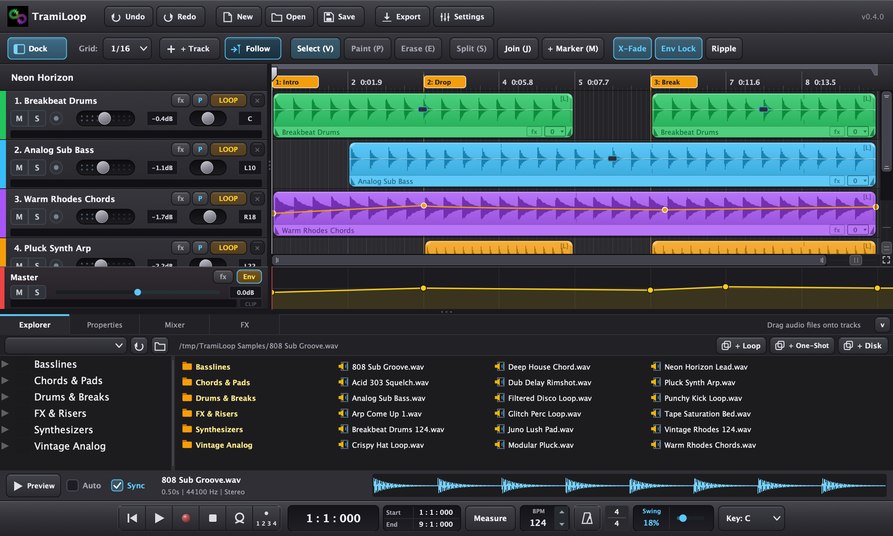

# TramiLoop

A fast, straightforward multitrack loop-based audio DAW for macOS and Windows.

Built around a single horizontal **Song** timeline with tempo-synced time-stretching, external VST3/AudioUnit plugin hosting, and an integrated multi-purpose bottom dock (**Explorer**, **Properties**, **Mixer**, and **FX Rack**), **TramiLoop** provides an immediate, distraction-free environment for building tracks and full songs.



---

## Key Features

- **Multitrack Song Timeline**:
  - Dynamic tracks with individual volume, pan (with clickable dB/Pan readouts), mute, solo, record arm, live stereo peak meters, 32-color track picker, and track type (`LOOP`, `1-SHOT`, `DISK`).
  - Selectable time signatures (`2/4`, `3/4`, `4/4`, `5/4`, `6/4`, `7/4`, `3/8`, `6/8`, `7/8`, `9/8`, `12/8`, `2/2`, or custom meters) and grid snap resolutions (**1 Bar, 1/2, 1/4, 1/8, 1/16, and 1/32**).
  - Full clip editing tools: **Select (`V`)**, **Paint (`P`)**, **Erase (`E`)**, **Split (`S`)**, **Join (`J`)**, **Reverse (`R`)**, and timeline **Markers (`M`)**.
  - Clip bottom bar displaying clip name, clickable **`fx`** badge, and clickable pitch/transpose selector.
  - Paint directly in the timeline ruler to define or adjust the loop region, or use the zoomable horizontal/vertical scrollbars.
  - Live real-time editing: reversing, transposing, moving, or adjusting envelopes on playing clips is reflected immediately in audio playback.

- **Multi-Purpose Bottom Dock (`Explorer` | `Properties` | `Mixer` | `FX`)**:
  - **Explorer**: Dual-pane ACID-style file browser with a folder tree on the left, multi-column audio file & subfolder view on the right, tempo/key-synced live auditioning, inline waveform preview, and drag-and-drop onto tracks.
  - **Properties**: Docked track & sample inspector with `General`, `Stretch` (interactive transient markers with 1x–16x zoom & pan), and `Summary` metadata tabs.
  - **Mixer**: Side-by-side track channel strips with color bars, `FX` buttons, `M`/`S` toggles, pan controls, vertical volume faders, live 30 Hz stereo peak meters, editable dB readouts, bidirectional track selection sync, and a pinned **Master** strip.
  - **FX Rack**: Searchable VST3/AU plugin browser paired with a horizontal signal-flow rack (`IN → [Module] → OUT`) supporting **`Track FX`**, **`Clip FX`**, and **`Master FX`** chains.

- **External VST3 / AudioUnit Plugin Hosting (Zero Built-In Effects)**:
  - Host external **VST3** (macOS & Windows) and **AudioUnit** (macOS) effect plugins on individual **Clips**, **Tracks**, or the **Master Bus**.
  - Scan system plugin directories, reorder/bypass modules, open floating non-modal native plugin UI windows, and persist plugin states with the project.

- **Master Bus Track & Multi-Point Envelopes**:
  - Docked Master Bus lane at the bottom of the timeline with Master **Mute All (`M`)** and **Solo All (`S`)**, Master Volume slider + dB readout, **`fx`** rack, **`Env`** toggle, live stereo peak meter, and a latched **`CLIP`** indicator (click to reset).
  - Drawable multi-point Volume and Pan envelopes on clips, track Volume / Pan / FX automation lanes, and Master Volume Automation with point-by-point Undo/Redo.

- **Tempo-Synced Time-Stretching (Rubber Band)**:
  - Loops automatically time-stretch to the song's BPM and conform to project key/transpose settings.
  - One-shots play at their natural pitch and speed; Disk-Based tracks stream long audio files.
  - Background rendering via `StretchCache` keeps the real-time audio thread and UI non-blocking.

- **Project Bundles, Recording, Undo/Redo & Offline WAV Export**:
  - In-place audio recording with 1-bar metronome count-in and automatic input latency compensation.
  - Self-contained project folders (`project.trami` JSON + `samples/` audio folder) plus legacy `.acd` / `.acd-zip` import.
  - Offline WAV mixdown export (16-bit / 24-bit at 44.1 kHz or 48 kHz).

---

## Installing Prebuilt Releases (macOS & Windows)

Prebuilt installers (`TramiLoop-v<version>-macOS.dmg` and `TramiLoop-v<version>-Windows-Setup.exe`) and portable `.zip` archives are attached to each GitHub Release. If a release binary is unsigned, macOS Gatekeeper or Windows SmartScreen may show a warning on first launch:

### macOS
1. Open `TramiLoop-v<version>-macOS.dmg` and drag **TramiLoop.app** to **Applications**.
2. If Gatekeeper blocks first launch, clear the quarantine attribute in Terminal:
   ```bash
   xattr -cr /Applications/TramiLoop.app
   ```
   *(Alternatively, right-click `TramiLoop.app` → **Open**, or allow it under **System Settings → Privacy & Security → Open Anyway**.)*

### Windows
1. Run `TramiLoop-v<version>-Windows-Setup.exe` (installs per-user with Start Menu shortcut and `.trami` file association; no Administrator UAC prompt required).
2. If SmartScreen shows *"Windows protected your PC"*, click **More info** → **Run anyway**.

---

## Keyboard Shortcuts

| Shortcut | Action |
|---|---|
| `Space` | Play / Pause |
| `0` | Stop Playback |
| `Return` | Return to Start (Rewind) |
| `V` | Select / Move Tool |
| `P` | Paint / Draw Tool |
| `E` | Erase Tool |
| `S` | Split Tool |
| `J` | Join Selected Clips |
| `R` | Reverse Selected Clip(s) |
| `M` | Add Timeline Marker at Playhead |
| `F` | Toggle Playhead Follow (Auto-Scroll) |
| `B` | Toggle Bottom Dock (`Explorer` / `Properties` / `Mixer` / `FX`) |
| `Cmd + Z` / `Ctrl + Z` | Undo |
| `Cmd + Shift + Z` / `Ctrl + Y` | Redo |
| `Cmd + N` / `Ctrl + N` | New Project |
| `Cmd + O` / `Ctrl + O` | Open Project |
| `Cmd + S` / `Ctrl + S` | Save Project |
| `Cmd + E` / `Ctrl + E` | Export Mixdown to WAV |
| `Cmd + +` / `Cmd + =` | Zoom In (Horizontal) |
| `Cmd + -` | Zoom Out (Horizontal) |
| `Cmd + 0` | Reset Zoom |
| `Cmd + Shift + +` / `Cmd + Shift + -` | Increase / Decrease Track Height |

---

## Building from Source

### Prerequisites
- CMake 3.24 or higher
- C++20 compliant compiler (Apple Clang 14+, Clang 14+, GCC 12+, MSVC 2022+)

All third-party dependencies (JUCE 8, Rubber Band, Catch2) are automatically fetched via CMake at configure time.

### Build Instructions (macOS & Windows)

```bash
# Configure
cmake -S . -B build -DCMAKE_BUILD_TYPE=Release

# Build application and unit tests
cmake --build build --config Release --parallel

# Run test suite (98 unit tests)
ctest --test-dir build -C Release --output-on-failure
```

### Launching

On macOS:
```bash
open build/src/TramiLoop_artefacts/Release/TramiLoop.app
```

On Windows:
```cmd
.\build\src\TramiLoop_artefacts\Release\TramiLoop.exe
```

---

## Architecture & Code Structure

The codebase is organized into clean, modular layers:
- `src/model/`: Pure C++ domain model (`Song`, `Pattern`, `Sample`, `Timing`, `UndoManager`). Zero GUI dependencies, completely unit-testable.
- `src/engine/`: Real-time audio engine running lock-free on the audio callback (`AudioEngine`, `Sequencer`, `SnapshotExchange`, `SnapshotBuilder`, `PluginHost`, `TimeStretcher`, `StretchCache`, `AudioRecorder`).
- `src/io/`: File and project I/O (`ProjectSerializer`, `SampleImporter`, `WavExporter`, legacy project/metadata readers).
- `src/ui/`: JUCE Component hierarchy (`MainContainer`, `PatternView`, `PatternGrid`, `TrackHeader`, `BottomDockPanel`, `SampleBrowserPanel`, `TrackPropertiesDialog`, `MixerPanel`, `FxRackPanel`, `TransportBar`, `TramiLookAndFeel`).
- `tests/`: Catch2 unit test suite (98 test cases) covering musical timing & grooves, model consistency, real-time sequencer & plugin hooks, time stretching, serialization, and WAV export.

---

## Code Signing Policy

Free code signing on Windows is provided by [SignPath.io](https://signpath.io/), certificate by [SignPath Foundation](https://signpath.org/).

- **Committers & Reviewers**: [Benjamin Bischoff](https://github.com/benjaminbischoff)
- **Privacy Policy**: This program will not transfer any information to other networked systems unless specifically requested by the user or the person installing or operating it.

---

## License

This project is licensed under the GNU Affero General Public License v3 (AGPLv3) — see [LICENSE](LICENSE) for details.
