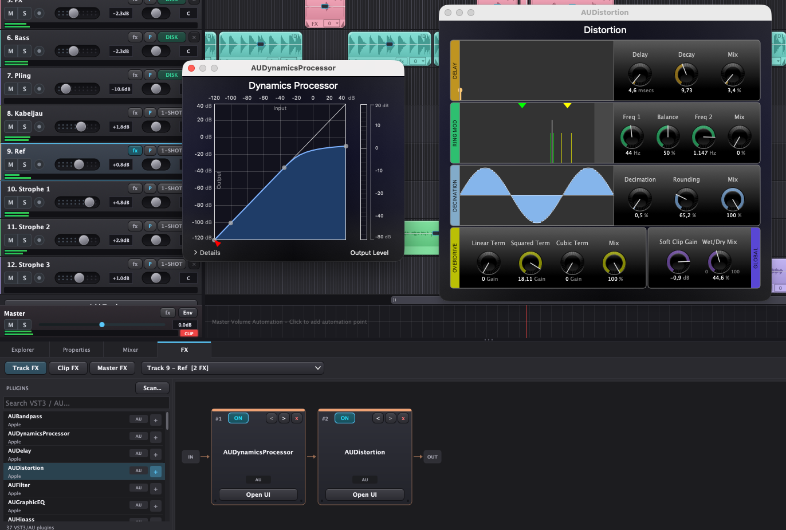

# TramiLoop

A fast, straightforward multitrack loop-based audio DAW for macOS and Windows.

Built around a single horizontal **Song** timeline with tempo-synced time-stretching, external VST3/AudioUnit plugin hosting, and an integrated multi-purpose bottom dock (**Explorer**, **Properties**, **Mixer**, and **FX**), **TramiLoop** gives you an immediate, distraction-free environment for arranging loops, recording audio, mixing tracks, and finishing full songs.


---

## Key Features

- **Multitrack Song Timeline**:
  - Dynamic tracks with volume, pan, editable dB/Pan readouts, Mute (`M`), Solo (`S`), Record Arm (`•`), live 30 Hz stereo peak meters, a **32-color track picker**, and per-track playback modes (**`LOOP`**, **`1-SHOT`**, **`DISK`**).
  - Flexible time signatures (`2/4`, `3/4`, `4/4`, `5/4`, `6/4`, `7/4`, `3/8`, `6/8`, `7/8`, `9/8`, `12/8`, `2/2`, or custom meters), grid snap resolutions (**1 Bar** down to **1/32**), and adjustable **Swing** & **Project Key** conforming.
  - Real-time live editing: reversing, transposing, moving, splitting, or drawing envelopes on clips while playing is heard immediately without stopping playback.
- **External VST3 & AudioUnit Plugin Hosting (Zero Built-In Effects)**:
  - Host your own **VST3** (macOS & Windows) and **AudioUnit** (macOS) effect plugins on individual **Clips**, **Tracks**, or the **Master Bus**.
  - Horizontal signal-flow rack (`IN → [Module] → OUT`) with live plugin search, bypass/reorder controls, floating non-modal native plugin UIs, and full plugin state persistence in saved projects.
- **Multi-Purpose Bottom Dock (`Explorer` | `Properties` | `Mixer` | `FX`)**:
  - **Explorer**: Dual-pane file browser with folder tree, multi-column audio view, inline waveform preview, and tempo/key-synced live auditioning.
  - **Properties**: Track & sample inspector with `General`, `Stretch` (interactive transient stretch markers with 1×–16× zoom & pan), and `Summary` metadata tabs.
  - **Mixer**: Console-style vertical channel strips with color bars, `FX` buttons, `M`/`S` toggles, pan controls, volume faders, live stereo peak meters, and a pinned **Master** strip.
  - **FX**: Searchable VST3/AU browser paired with the horizontal signal-flow rack for `Track FX`, `Clip FX`, and `Master FX`.
- **Master Bus Lane & Multi-Point Automation**:
  - Docked Master Bus track at the bottom of the timeline with Master **Mute All (`M`)**, **Solo All (`S`)**, Master Volume slider + dB readout, **`fx`** rack, **`Env`** toggle, live stereo peak meter, and a latched **`CLIP`** indicator.
  - Multi-point clip Volume & Pan envelopes, per-track Volume / Pan / FX automation lanes, and Master Volume Automation with Undo/Redo.
- **Tempo-Synced Time-Stretching (Rubber Band)**:
  - `LOOP` tracks automatically time-stretch to the song BPM and conform to the project key.
  - `1-SHOT` tracks play at natural pitch and speed; `DISK` tracks stream long audio recordings.
- **Recording, Project Bundles & WAV Export**:
  - In-place audio recording with 1-bar metronome count-in and automatic input latency compensation.
  - Self-contained `.trami` project bundles (`project.trami` + `samples/`) plus legacy `.acd` / `.acd-zip` import.
  - Offline WAV mixdown export (16-bit / 24-bit at 44.1 kHz or 48 kHz).

---

## Using TramiLoop

### 1. Browsing & Adding Audio
1. Open the **Explorer** tab in the bottom dock (toggle with `B`) and navigate to your sample folders.
2. Click any `.wav` or `.mp3` file to audition it — enable **Sync** to hear loops time-stretched to your song's BPM and conformed to your project key in real time.
3. Drag and drop audio files directly onto any track, onto empty space to create a new track, or use **`+ Loop`**, **`+ One-Shot`**, or **`+ Disk`** to add them immediately.
4. Click a track's mode badge (`LOOP` / `1-SHOT` / `DISK`) at any time to switch how that track behaves.

### 2. Editing Clips, Loops & Envelopes
- **Edit Tools**: Switch between **Select (`V`)**, **Paint (`P`)** to draw repeated loop clips, **Erase (`E`)**, and **Split (`S`)** to slice clips on click. Use **Join (`J`)** to merge adjacent clips and **Reverse (`R`)** to flip playback direction live.
- **Pitch & Clip FX**: Every clip's bottom bar shows its name, a clickable **`fx`** badge (left-click to open its Clip FX chain; right-click or `Alt+click` to bypass all Clip FX), and a clickable pitch selector (`0 ▾`) to transpose in semitones.
- **Multi-Point Envelopes**: Right-click a clip to add volume or pan envelope presets, then **left-click** on the curve to add and drag points or **right-click** any point to delete it.
- **Loop Region & Zooming**:
  - Click and drag across the **top blue bar** of the ruler to paint a loop region (double-click to reset).
  - Drag **up/down** on the bar numbers below the loop bar to zoom horizontally, or drag the **ends of the horizontal/vertical scrollbars** for smooth 1:1 zooming.
- **Workflow Toggles**:
  - **`X-Fade`**: Automatically crossfades overlapping clips on the same track.
  - **`Env Lock`**: Moves track automation points together with clips when you drag them.
  - **`Ripple`**: Deleting a clip automatically pulls downstream clips on that track earlier.
- **Timeline Markers**: Press `M` (or click **`+ Marker (M)`**) to drop named section markers (`Intro`, `Drop`, `Break`) in the ruler.

### 3. Mixing, Multi-Track Grouping & Colors
- **Track Colors**: Click the colored strip on the left edge of any track header to pick from **32 colors** (or reset to Auto). Double-click a track's name to rename both the track and its clips.
- **Multi-Track Selection**: Hold **`Cmd`/`Ctrl`** to toggle individual tracks or **`Shift`** to select a range of tracks. When multiple tracks are selected:
  - **Mute (`M`)**, **Solo (`S`)**, **Record Arm (`•`)**, and **Track Color** apply to all selected tracks at once.
  - Dragging **Volume** or **Pan** adjusts all selected tracks **relatively** to their current levels.
- **Mixer & Master Bus**: Switch the bottom dock to **Mixer** for vertical channel strips synced with your track selection. The docked **Master** lane at the bottom of the timeline provides Master `M`/`S`, Master Volume, a latched **`CLIP`** indicator (click to clear), and a drawable **Master Volume Automation** curve (`Env`).

### 4. Hosting External VST3 & AudioUnit Effects



1. Open the **FX** tab in the bottom dock (or click **`fx`** on any Clip, Track header, Mixer strip, or Master lane).
2. Click **`Scan...`** to index your system VST3 (macOS/Windows) and AudioUnit (macOS) effect plugins.
3. Filter plugins with the search bar and click **`+`** to insert modules into the horizontal **`IN → [Plugin] → OUT`** chain for **Track FX**, **Clip FX**, or **Master FX**.
4. Click **`Open UI`** on any module to open its floating native editor window while continuing to play and edit your song. Use **`ON`** to bypass individual plugins, **`<`** / **`>`** to reorder the chain, or right-click / `Alt+click` any `fx` button to bypass the whole chain.

### 5. Recording, Saving & Exporting
- **Recording**: Arm a track (`•`) and press Record in the transport bar for a 1-bar metronome count-in with automatic input latency compensation.
- **Projects**: Save (`Cmd/Ctrl+S`) creates a self-contained project folder (`project.trami` + `samples/`). You can also open existing `.trami` projects or import legacy `.acd` / `.acd-zip` files (`Cmd/Ctrl+O`).
- **WAV Export**: Click **Export** (`Cmd/Ctrl+E`) to render an offline stereo WAV mixdown (16-bit or 24-bit, 44.1 kHz or 48 kHz).

---

## Installing Prebuilt Releases (macOS & Windows)

Prebuilt installers (`TramiLoop-v<version>-macOS.dmg` and `TramiLoop-v<version>-Windows-Setup.exe`) and portable `.zip` archives are attached to each GitHub Release. If a release binary is unsigned, macOS Gatekeeper or Windows SmartScreen may show a warning on first launch:

### macOS
1. Open `TramiLoop-v<version>-macOS.dmg` and drag **TramiLoop.app** to **Applications**.
2. If Gatekeeper blocks first launch, clear the quarantine attribute in Terminal:
   ```bash
   xattr -cr /Applications/TramiLoop.app
   ```
   *(Alternatively, right-click `TramiLoop.app` → **Open**, or allow it under **System Settings → Privacy & Security → Open Anyway**.)*

### Windows
1. Run `TramiLoop-v<version>-Windows-Setup.exe` (installs per-user with Start Menu shortcut and `.trami` file association; no Administrator UAC prompt required).
2. If SmartScreen shows *"Windows protected your PC"*, click **More info** → **Run anyway**.

---

## Keyboard Shortcuts

| Shortcut | Action |
|---|---|
| `Space` | Play / Pause |
| `0` | Stop Playback |
| `Return` | Return to Start (Rewind) |
| `V` | Select / Move Tool |
| `P` | Paint / Draw Tool |
| `E` | Erase Tool |
| `S` | Split Tool |
| `J` | Join Selected Clips |
| `R` | Reverse Selected Clip(s) |
| `M` | Add Timeline Marker at Playhead |
| `F` | Toggle Playhead Follow (Auto-Scroll) |
| `B` | Toggle Bottom Dock (`Explorer` / `Properties` / `Mixer` / `FX`) |
| `Cmd + Z` / `Ctrl + Z` | Undo |
| `Cmd + Shift + Z` / `Ctrl + Y` | Redo |
| `Cmd + N` / `Ctrl + N` | New Project |
| `Cmd + O` / `Ctrl + O` | Open Project |
| `Cmd + S` / `Ctrl + S` | Save Project |
| `Cmd + E` / `Ctrl + E` | Export Mixdown to WAV |
| `Cmd + +` / `Cmd + =` | Zoom In (Horizontal) |
| `Cmd + -` | Zoom Out (Horizontal) |
| `Cmd + 0` | Reset Zoom |
| `Cmd + Shift + +` / `Cmd + Shift + -` | Increase / Decrease Track Height |

---

## Building from Source

### Prerequisites
- CMake 3.24 or higher
- C++20 compliant compiler (Apple Clang 14+, Clang 14+, GCC 12+, MSVC 2022+)

All third-party dependencies (JUCE 8, Rubber Band, Catch2) are fetched automatically via CMake at configure time.

```bash
# Configure
cmake -S . -B build -DCMAKE_BUILD_TYPE=Release

# Build application and unit tests
cmake --build build --config Release --parallel

# Run test suite
ctest --test-dir build -C Release --output-on-failure
```

Launch the built app with `open build/src/TramiLoop_artefacts/Release/TramiLoop.app` (macOS) or `.\build\src\TramiLoop_artefacts\Release\TramiLoop.exe` (Windows).

---

## Code Signing Policy

Free code signing on Windows is provided by [SignPath.io](https://signpath.io/), certificate by [SignPath Foundation](https://signpath.org/).

- **Committers & Reviewers**: [Benjamin Bischoff](https://github.com/bischoffdev)
- **Privacy Policy**: This program will not transfer any information to other networked systems unless specifically requested by the user or the person installing or operating it.

---

## License

This project is licensed under the GNU Affero General Public License v3 (AGPLv3) — see [LICENSE](LICENSE) for details.
